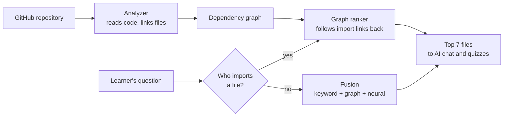

# The CodeAI Paper, Explained Simply

A plain-language guide to [CodeAI: When Does Code Structure Help?](codeai-hybrid.typ). Every number here comes from the paper.

## The short version

The paper finds that the best way to find code depends on the question: a map of which files use which beats keyword search for "who uses this file?", and AI-based meaning search beats keyword search for "where is this feature?". Using these findings, the team rebuilt CodeAI's search, and it now puts the right file first far more often.

The paper is *CodeAI: When Does Code Structure Help?*, a B.Tech capstone research report from VIT-AP University. This page retells it without the maths.

Three takeaways:

- **Match the method to the question.** Questions about how files connect need the dependency map. Questions about what code does need meaning-based search.
- **Combining methods helps, but only when each one is good.** Mixing in a weak method made results worse.
- **One idea did not work.** A new trick for trimming the map down to the few important links ("Graph Path Pruning") did no better than simple shortcuts. The paper reports this honestly.

## The problem: picking the right files

CodeAI helps developers learn a codebase they did not write. You connect a GitHub repository, then ask questions in a chat or take quizzes made from that code.

A repository can have hundreds of files, far too many for the AI model to read at once. So before every answer, CodeAI has to pick about 7 files to show the model. If it picks the wrong ones, the answer is wrong no matter how smart the model is. **This file-picking step (called retrieval) is what the paper studies.**

Learners ask three kinds of question again and again:

| Question type | Everyday example | What a good answer needs |
| --- | --- | --- |
| Locate | "Where is the code that converts data to a form?" | Understand what the code does |
| Direct importers | "Which files import `lib/request.js`?" | Know which file uses which |
| Change impact | "What breaks if `lib/utils.js` changes?" | Follow the chain of users, a few steps deep |

There are two broad ways to search. **Text-based** methods read what is written inside files. **Structure-based** methods read a map of how files depend on each other. The paper asks: which kind works for which question?

## How CodeAI works

CodeAI first reads the whole repository and builds a map of it, then uses that map and the file text to rank files for each question.

1. **Read the code.** A parser (Tree-sitter) reads every JavaScript and Python file and lists its functions, classes and variables.
2. **Connect the files.** It works out which file imports or calls which. For example, `import x from './utils'` becomes a link from this file to `utils.js`.
3. **Build the map.** All files, functions and links go into one dependency graph. The same repository always gives the same graph.
4. **Rank files for a question.** A "ranker" scores every file and returns them in order. The top few go to the AI model.

The analyzer builds the map once per repository. Each question then goes to the graph alone if it asks who imports a file, and to a mix of methods otherwise.

### The search methods compared

The paper tests eight rankers on the same questions:

| Ranker | How it works, in one line |
| --- | --- |
| BM25 | Classic keyword search: files sharing rare words with the question rank high |
| CodeAI v1 | CodeAI's original search: BM25 plus a bonus when question words match function names |
| LSA | An older maths trick that groups words that often appear together |
| Neural dense (bge-small) | A small AI model turns text into numbers that capture meaning, so "save" can match "store" |
| Graph | Uses only the map: file and function names, and who imports whom. Never reads file contents |
| Fusion (3 kinds) | Merges two or three rankers' lists into one, using Reciprocal Rank Fusion |

**Reciprocal Rank Fusion** works like pooling votes: a file that several rankers place near the top gets a high combined score.

The team also built **Graph Path Pruning**. For a question like "how are sessions stored in cookies?", it tries to return only the 2 or 3 file-to-file links that explain the behaviour, instead of dozens.

## How it was tested fairly

The team built a test of 710 questions over 19 public open-source repositories (15 JavaScript, 4 Python), plus 48 hand-written "flow" questions for the pruning method. They took four precautions so the test could not be gamed.

- **Answer keys from outside tools.** The correct answers came from separate tools (text pattern matching, and Python's own `ast` parser), not from CodeAI's own map. Otherwise the graph ranker would be graded by its own homework.
- **Comments removed.** Locate questions were made from code comments, like "Convert a data object to FormData". If comments stayed in, keyword search could just find the exact sentence. So all comments were stripped before searching. This one change dropped keyword search from about 0.9 to about 0.35 on the main score, which shows how much the earlier test had flattered it.
- **Held-out repositories.** Five repositories (`request`, `winston`, `mocha`, `redux-saga`, `body-parser`) were never looked at while designing the methods. Results on these five are the most trustworthy, like a final exam with unseen questions.
- **Careful statistics.** When you run many comparisons, some look like wins by pure luck. The team fixed a list of 18 comparisons in advance and applied the Holm correction, a stricter bar that filters out lucky wins. A result is called "significant" only if it clears that bar.

### How to read the scores

All scores run from 0 to 1, higher is better.

- **MRR (mean reciprocal rank):** 1.0 means the right file is always first; 0.5 means it is second on average; 0.33 means third.
- **nDCG@10:** how well the top 10 results put correct files near the top, for questions with many right answers.
- **F1:** for flow questions, a balance between returning the right links and not returning wrong ones.

## What they found

No single method wins everywhere: meaning-based search wins at finding code, the dependency map wins at "who uses this", and a good mix of both is safest overall.

Scores on the five unseen JavaScript repositories (best per column in bold):

| Ranker | Locate (MRR) | Who imports X (MRR) | What breaks if X changes (nDCG@10) |
| --- | --- | --- | --- |
| BM25 keyword search | 0.32 | 0.68 | 0.59 |
| CodeAI v1 (old) | 0.43 | 0.68 | 0.58 |
| Neural dense | 0.50 | 0.54 | 0.27 |
| Graph | 0.45 | **0.97** | 0.74 |
| Fusion: BM25 + neural + graph | **0.58** | 0.93 | **0.85** |

### 1. Finding code: meaning beats keywords

The neural model beat keyword search clearly (0.50 vs 0.32 on JavaScript, and a similar gap on Python). The graph ranker came close (0.45) just by matching file and function names. Mixing all three was best.

Why keywords lose: questions and code often use different words. When few question words appear in the answer file, keyword search scores only 0.16, while the mix still scores 0.50.

### 2. "Who uses this file?": the map wins easily

The graph ranker scored 0.97, against 0.68 for keyword search. The paper is honest that this is close to a lookup, since the map stores exactly this information. It mainly proves the map is accurate.

### 3. "What breaks?": the map helps, neural does not

The graph (0.74) beat keyword search (0.59), and the neural model did badly (0.27). Files that depend on `utils.js` don't need to look like `utils.js`. With only 37 test questions, this gap did not pass the strict statistics bar.

### 4. Mixing helps only with good partners

On Python, mixing the graph with the weak LSA method made "what breaks" results significantly worse (down 0.11). Mixing the graph with the neural model made them better. A weak partner drags the team down.

### 5. Graph Path Pruning did not beat shortcuts

Pruning cut the links returned by 95%, from about 37 per question to about 2. But simply taking the top 3 links by file-name words scored better (F1 0.30 vs 0.20). On 8 of 25 questions the pruner returned nothing at all, because its fixed score cut-off was set too high. None of the flow comparisons passed the strict statistics bar.

### 6. The code map is accurate

Checked against Python's own parser, the analyzer found 100% of 4,596 Python functions and classes, 96.8% of Python import links, 96.4% of direct cross-file calls, and 98.5% of JavaScript import links.

### 7. CodeAI got better

The team rebuilt CodeAI's search (v2): "who imports" questions go straight to the map, and everything else uses a mix of keyword, map and neural rankings. LSA and pruning were dropped. The neural part is optional, so search still works if the model isn't installed or takes over 2.5 seconds.

| Question type (unseen JavaScript) | v1 before | v2 after |
| --- | --- | --- |
| Locate (MRR) | 0.43 | 0.58 |
| Who imports X (MRR) | 0.68 | 0.97 |
| What breaks (nDCG@10) | 0.58 | 0.78 |

All three gains are significant. One caveat the paper states: v2 was designed after seeing these results, so this confirms the design rather than testing it fresh.

## Limits and next steps

The study measures file-picking only, not whether the AI's final answers or quizzes got better. That is the biggest open question.

Other limits the paper names:

- **Questions came from code comments,** not from real developers asking things. Real questions may be messier.
- **The flow questions were written by one person,** who also built the pruner, with no second checker.
- **The test is small and hand-picked:** 19 repositories, mostly libraries of a few hundred files. Some held-out groups had only 37 to 79 questions, so "not significant" often means "not enough data" rather than "no effect".
- **Some choices were made after seeing results,** such as a fix to Python import matching and the v2 design. The paper flags each one.
- **Only one small neural model was tested.** Bigger, code-trained models might do better.

Planned next steps: feed each ranker's files to an AI model and grade the answers, collect real developer questions, test bigger models, and fix the pruner's score cut-off before testing it on new questions.

## Glossary

| Term | Plain meaning |
| --- | --- |
| Repository (repo) | A project's full set of code files, usually on GitHub |
| Retrieval | Picking which files to show the AI model before it answers |
| Ranker | A method that sorts files from most to least relevant |
| Dependency graph | A map of files and functions with arrows for "imports" or "calls" |
| BM25 | Standard keyword search, like a basic search engine |
| LSA | Latent semantic analysis: an older, non-AI way to group related words |
| Neural / dense embedding | An AI model that turns text into numbers so similar meanings sit close together |
| Reciprocal Rank Fusion (RRF) | Merging several ranked lists by rewarding files that rank high in many of them |
| Graph Path Pruning | The team's method for keeping only the few links that explain a behaviour |
| Held-out | Test data kept hidden during design, so results are not biased |
| MRR | Average of 1 ÷ (position of the first right file); 1.0 means always first |
| nDCG@10 | How well the top 10 results put right files near the top |
| F1 | A score balancing "found the right items" and "avoided wrong items" |
| Holm correction | A stricter test bar used when making many comparisons, to filter out lucky wins |
| Significant | Passed that bar, so unlikely to be chance |
| Tree-sitter | A tool that reads source code and understands its structure |
